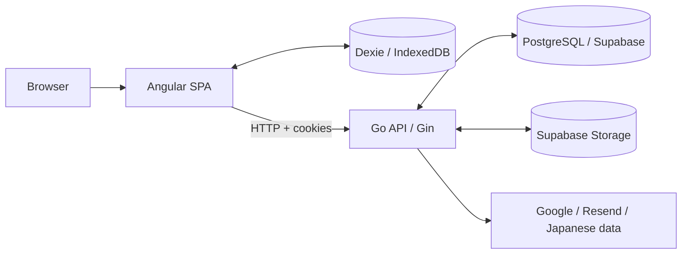

# FreeHonGo

FreeHonGo is a Japanese language practice application focused on character recognition, reading, meanings, writing practice, quizzes, custom lists and progress tracking.

The project is split into an Angular frontend and a Go API. Practice data is kept locally first in the browser with Dexie and can be synchronized with the backend when the user is authenticated.

## Features

- Japanese kana and kanji lookup.
- Character picker with filters, ordering and infinite scroll.
- Reading, meaning and stroke-order quizzes.
- Private, public and official character lists.
- Offline-first local storage with Dexie.
- Synchronization of lists, quiz sessions and statistics.
- Dashboard, authentication, profile management and profile pictures.

## Architecture



See [architecture](docs/architecture.md) and [database documentation](docs/database.md).

## Repository structure

```text
.
├── backend/                Go API, services, repositories and handlers
├── freehongo/              Angular application
├── schemas/                PostgreSQL schemas and migrations
├── build_kanji_db_scripts/ Data preparation utilities
└── docs/                   Architecture, diagrams and ADRs
```

## Requirements

- Node.js and npm.
- Go 1.26 or the version declared in `backend/go.mod`.
- PostgreSQL/Supabase for a fully functional backend.
- TLS certificate files for local backend development when `APP_ENV=development`.

## Local setup

### Frontend

```bash
cd freehongo
npm install
npm start
```

### Backend

Create a root `.env` file using the variables below, then run:

```bash
cd backend
go run ./cmd
```

The backend loads `../.env` when started from the `backend` directory.

### Makefile

```bash
make frontend
make backend
```

This commands can also be used to start development versions of the project.

### Database

Apply the base schemas in `schemas/`, followed by the migrations in numeric order.

## Environment variables

### Frontend / Vercel

The Angular build generates ignored environment files before compilation. Configure these variables in Vercel:

```text
FREEHONGO_API_URL=https://api.com/api
SUPABASE_URL=https://project.supabase.co
GOOGLE_CLIENT_ID=your-google-client-id
```

`FREEHONGO_API_URL` must not end with a slash. These values are client-visible configuration; never put a Supabase service key in the frontend.

### Backend

```text
APP_ENV=development
API_HOST=0.0.0.0
API_PORT=2582
API_ALLOWED_ORIGIN=https://frontend.com
GOOGLE_CLIENT_ID=...
RESEND_API_KEY=...
SUPABASE_URL=...
SUPABASE_SERVICE_KEY=...
OFFICIAL_USER_ID=...
DB_HOST=...
DB_PORT=...
DB_NAME=...
DB_USER=...
DB_PASSWORD=...
```

On Render, use the port supplied through `PORT` when `API_PORT` is not set. Health endpoints are `/health` and `/health/ready`.

## Useful commands

Frontend:

```bash
cd freehongo
npm run build
npm test
npx tsc --noEmit -p tsconfig.app.json
```

Backend:

```bash
cd backend
go test ./...
```

## Deployment

### Frontend on Vercel

- Root directory: `freehongo`
- Install command: `npm ci`
- Build command: `npm run build`
- Output directory: `dist/freehongo/browser`

### Backend on Render

Configure the Go API to listen on `0.0.0.0` and use Render's `PORT` variable. Set `API_ALLOWED_ORIGIN` to the exact frontend origin.

## Documentation

- [Component documentation / styles guide](https://www.freehongo.edmondev.com/docs/styles) — visual reference for reusable components.
- [Documentation index](https://www.freehongo.edmondev.com/docs)
- [Architecture](docs/architecture.md)
- [Database and ER diagram](docs/database.md)
- [Japanese data pipeline](docs/data-pipeline.md)
- [ADR index and process](docs/adr/README.md)
- [ADR template](docs/adr/template.md)

## Screenshots

[Home screenshot](https://i.ibb.co/CKnmCCBm/Captura-de-pantalla-2026-11-23-013507-1.webp)
[Character picker screenshot](https://i.ibb.co/Ngns7sDk/Captura-de-pantalla-2026-11-23-235343.webp)
[Writing practice screenshot](https://i.ibb.co/tMx7YKfs/Captura-de-pantalla-2026-11-23-235422.webp)
[Dashboard screenshot](https://i.ibb.co/B2vnYZ3K/merge1.webp)
