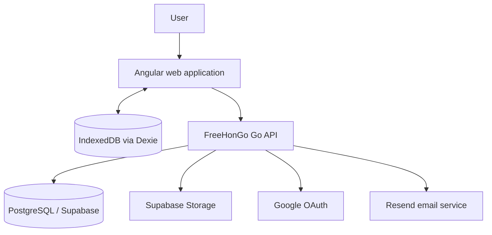
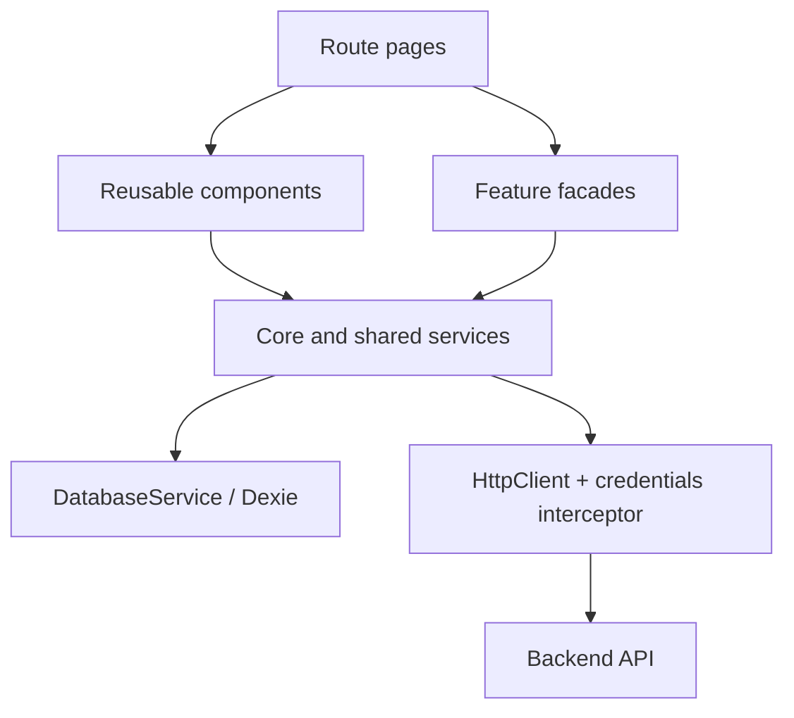
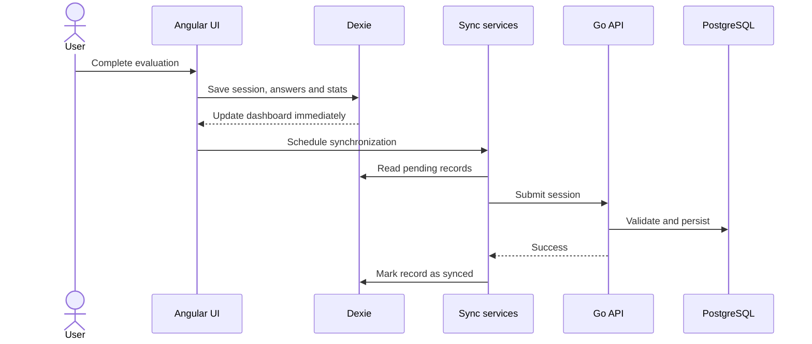
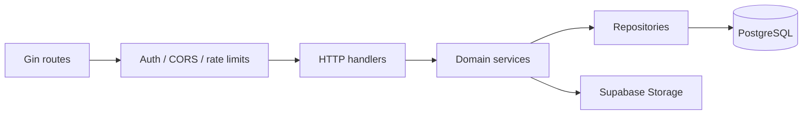

# Architecture

This document describes the architecture currently observable in the codebase. Historical motivations that are not recorded in the repository are listed as reconstructed in the ADRs.

## System context

## Frontend layers

- `features/`: feature-specific pages, components, facades and services.
- `shared/components/`: reusable UI primitives.
- `shared/services/`: authentication, theme, Japanese data and cross-feature behavior.
- `core/db/`: Dexie database and local persistence.
- `core/sync/`: list, quiz-session and statistics synchronization.
- `core/http/`: shared HTTP concerns.

Secondary routes are lazy-loaded. Chart.js and GSAP-heavy behavior are loaded only where needed.

## Offline-first practice flow

Practice-mode sessions are not stored as evaluation sessions. Evaluation sessions are saved locally first and synchronized when triggered by specific events, including user login or logout, the addition of new lists or sessions while authenticated, or manually by pressing the sync button.

## Public and official lists

Quiz routes carry a list source: `private`, `public` or `official`. Private lists are resolved through local/user-list storage. Public and official lists are resolved through their backend endpoints. The list name is kept as a small local session snapshot so quiz history still works offline when the list is not in Dexie.

## Backend layers

The backend exposes Japanese data, authentication, lists, quizzes, statistics and health/readiness endpoints.

## Health checks

- `/health`: process-level liveness response.
- `/health/ready`: readiness response that checks the database connection.
