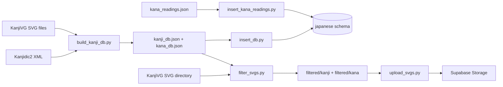

# Japanese data pipeline

The `build_kanji_db_scripts/` directory prepares the Japanese character data used by FreeHonGo. It combines metadata from Kanjidic2 with stroke geometry from KanjiVG, stores normalized JSON artifacts, inserts the data into PostgreSQL and publishes character SVGs to Supabase Storage.

## Pipeline overview



## Source files

Expected source data lives under `build_kanji_db_scripts/kanji_source_files/`:

- `kanjidic2.xml`: kanji metadata, readings, meanings, JLPT, grade and nanori.
- `kanjivg/kanji/`: source SVGs containing stroke paths.
- `kana_readings.json`: kana reading values used to complete the kana records.

The repository also contains generated JSON and SVG output. Large source/output collections should be treated as data artifacts rather than hand-edited application code.

## Scripts

### `parse_kanjidic2.py`

Parses Kanjidic2 XML into Python dictionaries keyed by normalized Unicode code point. It extracts literal, grade, stroke count, radical name, frequency, JLPT, readings, meanings and nanori.

### `parse_svg.py`

Parses KanjiVG SVG paths and samples each stroke into points. The default is 32 samples per stroke. This is the geometry consumed by the writing-practice features.

### `build_kanji_db.py`

Merges Kanjidic2 metadata with parsed SVG strokes. Kana that appears in the SVG collection is separated into `kana_db.json`; kanji metadata is written to `kanji_db.json`.

Arguments:

```text
python build_kanji_db.py <svg_folder> <kanjidic2_xml> [samples]
```

Example:

```bash
cd build_kanji_db_scripts
python build_kanji_db.py ./kanji_source_files/kanjivg/kanji ./kanji_source_files/kanjidic2.xml 32
```

### `filter_svgs.py`

Copies only SVGs represented in the generated JSON files into separate `filtered/kanji` and `filtered/kana` directories. It reports whether the number of copied files matches each JSON database.

Arguments:

```text
python filter_svgs.py <svg_folder> <kanji_db.json> <kana_db.json> <output_folder>
```

### `insert_db.py`

Inserts the generated JSON into the `japanese` PostgreSQL schema. It populates lookup tables first (`jlpt`, `grade`, `language`, `reading_type`), then inserts kana, kanji, readings, meanings and nanori.

Arguments:

```text
python insert_db.py <kanji_db.json> <kana_db.json>
```

The inserts use `ON CONFLICT DO NOTHING` for kana, kanji and lookup rows. Readings, meanings and nanori are inserted as related rows; verify the database state before rerunning against an existing dataset.

### `insert_kana_readings.py`

Updates `japanese.kana.reading` from `kana_readings.json`.

```text
python insert_kana_readings.py <kana_readings.json>
```

### `upload_svgs.py`

Uploads filtered kanji and kana SVGs to a Supabase Storage bucket, using `kanji/<unicode>.svg` and `kana/<unicode>.svg` paths.

```text
python upload_svgs.py <filtered_folder> [bucket]
```

The default bucket is `japanese-characters`. This script performs external writes and requires `SUPABASE_URL` and `SUPABASE_SERVICE_KEY`.

## Python dependencies

The scripts currently do not have a dedicated `requirements.txt`. Their imports indicate these dependencies:

```text
lxml
svgpathtools
psycopg2
python-dotenv
supabase
```

Create a virtual environment before installing them:

```bash
python -m venv .venv
.venv\Scripts\activate       # Windows
pip install lxml svgpathtools psycopg2-binary python-dotenv supabase
```

## Environment and safety

Database scripts use PostgreSQL variables such as `DB_HOST`, `DB_PORT`, `DB_NAME`, `DB_USER` and `DB_PASSWORD`. The upload script additionally uses `SUPABASE_URL` and `SUPABASE_SERVICE_KEY`.

Never commit the service key or a database password. Run the pipeline against a backup or a disposable database first. `insert_db.py` and `upload_svgs.py` are mutating operations; parsing and filtering are safer to run while validating source data.

## Relationship to the application schema

The output maps to the tables documented in [`database.md`](database.md):

- `kana_db.json` → `japanese.kana`.
- `kanji_db.json` → `japanese.kanji`, `kanji_reading`, `kanji_meaning`, `kanji_nanori` and lookup tables.
- Both kana and kanji → `japanese.characters` for unified foreign-key references.
- Filtered SVGs → Supabase Storage, not PostgreSQL.

