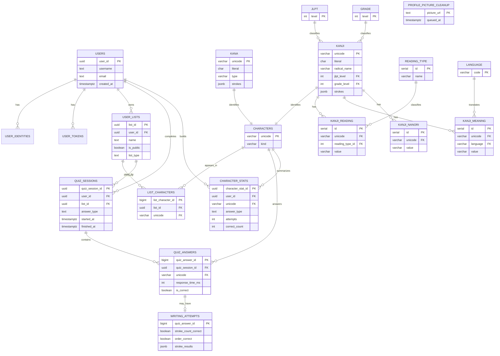

# Database documentation

The relational schema is split into two PostgreSQL schemas:

- `app`: users, identities, tokens, lists, quiz sessions, answers and statistics.
- `japanese`: kana, kanji, readings, meanings, nanori and the unified character index.

## Entity relationship diagram

## Modeling notes

- Official lists are rows in `app.user_lists` assigned to the official user and seeded by the official-list migration; there is no separate official-list table.
- Public access is controlled by `is_public`, `deleted_at` and RLS policies.
- `japanese.characters` unifies kana and kanji for foreign-key references.
- Local Dexie sessions may carry a `listName` snapshot for public/official quiz history.

## Types and accepted values

These are database `CHECK` constraints, not merely frontend options:

| Table / column                          | Accepted values or rule                                                                            |
| --------------------------------------- | -------------------------------------------------------------------------------------------------- |
| `app.user_identities.identity_provider` | `google`                                                                                           |
| `app.user_tokens.token_type`            | `session`, `password_reset`, `email_verification`                                                  |
| `app.user_lists.list_type`              | `hiragana`, `katakana`, `kanji`, `mixed`                                                           |
| `app.quiz_sessions.answer_type`         | `multiple`, `open`, `strokeWriting`                                                                |
| `app.quiz_sessions.character_quiz_type` | `characterToReading`, `readingToCharacter`, `characterToMeaning`, `meaningToCharacter`             |
| `app.quiz_sessions.total_questions`     | Greater than or equal to `2`                                                                       |
| `app.quiz_sessions` stroke rule         | `strokeWriting` only allows `readingToCharacter` or `meaningToCharacter`                           |
| `app.quiz_answers.response_time_ms`     | Greater than or equal to `0`                                                                       |
| `app.character_stats.answer_type`       | `multiple`, `open`, `strokeWriting`                                                                |
| `app.character_stats` counters          | `attempts >= 1`, `0 <= correct_count <= attempts`, `correct_streak >= 0`, `total_response_ms >= 0` |
| `app.character_stats` dates             | `last_seen_at >= first_seen_at`                                                                    |
| `japanese.characters.kind`              | `hiragana`, `katakana`, `kanji`                                                                    |

The following fields are required by `NOT NULL` constraints: user/list ownership IDs, list names, list type, quiz session identity/times/count/order, answer identity/timing/correctness, writing-attempt flags/results and character-stat counters/timestamps.

## Important columns omitted from the compact ER labels

The ER diagram emphasizes relationships, but the schema also contains:

- `app.users`: `password_hash`, `email_verified_at`, `created_at`, `updated_at`, `deleted_at`, `last_login_at` and `picture_url`.
- `app.user_identities`: `identity_provider`, `provider_user_id` and migration-added `created_at`.
- `app.user_tokens`: token hash, creation/expiration/revocation timestamps and `last_used_at`.
- `app.user_lists`: `created_at`, `updated_at`, `deleted_at`, `is_public` and `list_type`.
- `app.quiz_sessions`: `character_quiz_type`, `total_questions` and `random_order`.
- `app.quiz_answers`: `given_answer`, `expected_answer`, `confused_with` and `answered_at`.
- `japanese.kanji`: `frequency_of_use`, `radical_name`, `jlpt_level` and `grade_level`.
- `japanese.kana`: `stroke_count`, `reading` and `strokes`.

## Foreign-key behavior

- `list_characters.list_id` cascades when a list is deleted.
- User-owned identities, tokens, stats, lists and quiz sessions cascade when their user is deleted.
- Quiz answers cascade when their quiz session is deleted.
- Lists are deliberately preserved by the cleanup routine by reassigning them to the technical `[deleted-user]` account, because other users' quiz sessions may still reference them.
- Private orphan lists belonging to `[deleted-user]` can be removed when they are not referenced by any quiz session. Public lists are retained.

## RLS and roles

Migration `02_RLS_roles.sql` enables row-level security on application tables and creates ownership policies based on `app.current_user_id()`.

- `app_backend` receives the required application grants.
- Users can access their own users, identities, tokens, lists, quiz sessions, stats and related answers.
- Public lists and their characters receive additional read policies when `is_public = true` and `deleted_at IS NULL`.
- Service functions such as token validation and cleanup run with restricted `SECURITY DEFINER` behavior.

## Triggers and scheduled routines

- `app.set_updated_at()` updates `updated_at` for users and lists.
- `app.queue_deleted_user_picture()` queues old profile-picture URLs in `app.profile_picture_cleanup` before a user is deleted.
- `app.purge_stale_data()` removes expired tokens, handles stale/deleted users and cleans eligible private lists.
- `pg_cron` schedules `app.purge_stale_data()` daily at `09:00 UTC`.

## Migrations

Apply the base schemas in `schemas/`, then migrations in numeric order:

| Migration                                    | Purpose                                                                                          |
| -------------------------------------------- | ------------------------------------------------------------------------------------------------ |
| `01_user_info_google_requirements.sql`       | Adds user/identity timestamps, token constraints/indexes and soft-delete helpers.                |
| `02_RLS_roles.sql`                           | Creates backend role/functions and enables row-level security policies.                          |
| `03_RLS_public_lists.sql`                    | Allows public reads for public lists and their characters.                                       |
| `04_Periodic_routines_and_cascade.sql`       | Adds delete cascades, technical deleted user and daily cleanup routine.                          |
| `05_cleanup_deleted_user_lists.sql`          | Extends cleanup to remove unreferenced private orphan lists.                                     |
| `06_require_verified_email_for_sessions.sql` | Requires verified email for session-token validation.                                            |
| `07_profile_picture_cleanup.sql`             | Queues deleted profile-picture objects for storage cleanup.                                      |
| `08_official_lists`                          | Seeds official lists into `app.user_lists` with `is_public = true` and valid `list_type` values. |
